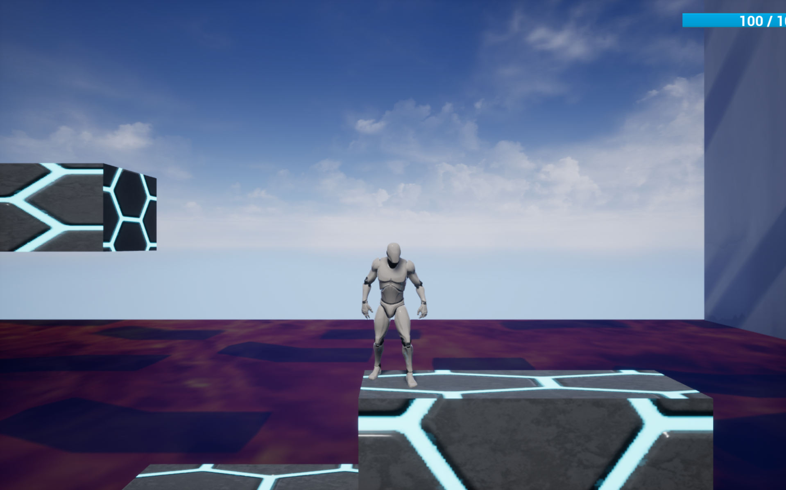

# Platformer UE4 Game

Status: Completed Unreal Engine project

I built this as an early Unreal Engine 4 platformer where the player climbs upward while lava rises from below.

## Overview

This was one of my first Unreal Engine builds. I focused on level layout, gameplay triggers, iteration, and publishing a playable build.

## Tools

- Unreal Engine 4
- Itch.io publishing
- Game design and level iteration

## What I Learned

This project helped me learn basic Unreal Engine project structure, level iteration, gameplay pacing, and publishing a playable build. The rising-lava mechanic made the level design more interesting because the player had to keep moving upward instead of exploring at their own pace.

## Portfolio

Portfolio page: [Platformer UE4 Game](https://wchowellarchive.web.app/Projects/FirstUE4Game/Platformer.html)

Download page: [itch.io project](https://carter619.itch.io/ruff-draft-ue4-game)
